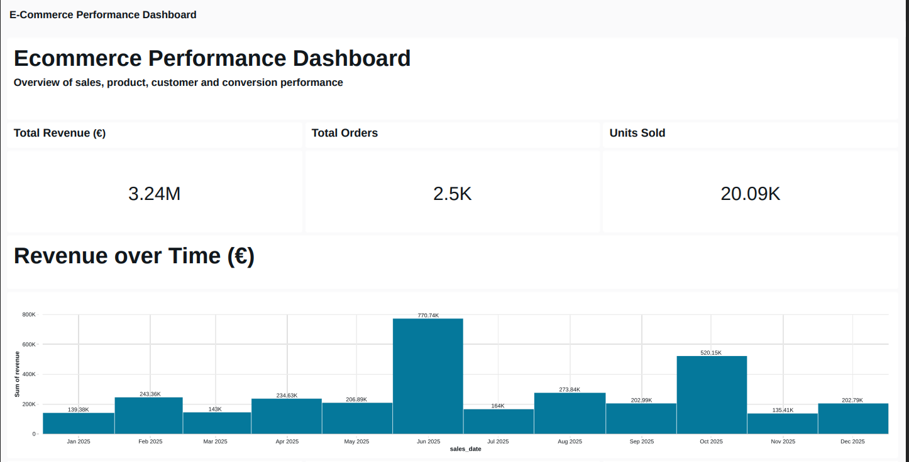
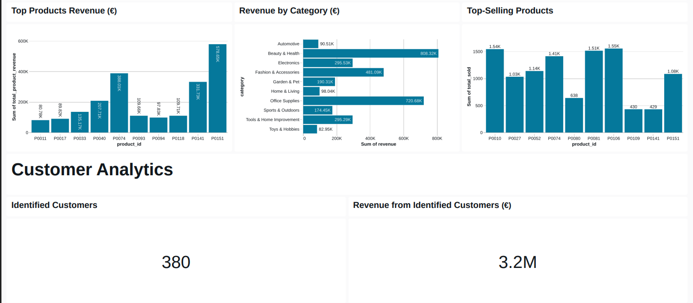
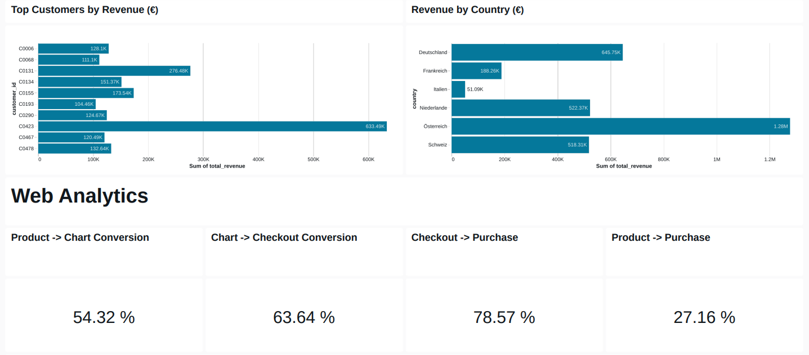
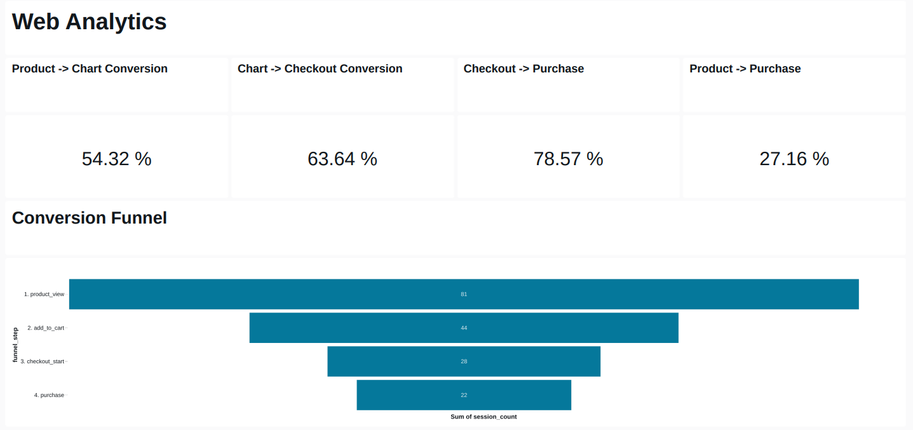

# E-Commerce Data Lakehouse

Production-inspired Data Engineering project implementing an end-to-end
E-Commerce Lakehouse using Databricks, PySpark, Spark SQL, Delta Lake,
and Unity Catalog.

## Project Overview

This project simulates a production-oriented E-Commerce data platform.
Raw data from multiple sources is ingested into Databricks, validated,
cleaned, transformed, and aggregated using a Medallion Architecture.

The final Gold Layer provides analytics-ready datasets for sales,
product, customer, and web conversion analysis.

## Architecture

Raw Data
   ↓
Bronze Layer
   ↓
Data Quality Validation
   ↓
Silver Layer
   ↓
Relationship Validation
   ↓
Gold Layer
   ↓
Gold Validation
   ↓
Databricks Dashboard

## Data Sources

The project uses four E-Commerce datasets:

- Orders (CSV)
- Customers (CSV)
- Product Catalog (JSON)
- Clickstream Events (JSON)

The datasets intentionally contain realistic data quality issues such as
duplicates, missing values, inconsistent formatting, invalid timestamps,
and anomalous values.

## Bronze Layer

Raw source data is ingested and stored without applying business
transformations.

Dedicated validation notebooks are used to identify data quality issues
before transformation.

## Silver Layer

The Silver Layer contains cleaned and standardized datasets.

Transformations include:

- Duplicate removal
- Date and timestamp standardization
- Categorical value normalization
- Data type corrections
- Handling of invalid and missing values
- Validation of customer and product relationships
- Preservation of values that cannot be reliably reconstructed

Cross-table relationships are validated after the transformations.

## Gold Layer

The Gold Layer contains analytics-ready datasets:

### Daily Sales
Daily revenue, order and sales metrics.

### Product Performance
Product-level revenue and sales performance.

### Customer Metrics
Customer-level purchasing and revenue metrics.

### Conversion Funnel
Session-based conversion funnel:

Product View → Add to Cart → Checkout Start → Purchase

## Data Quality Approach

Data quality issues are investigated before corrections are applied.

Values are only reconstructed when sufficient reference information is
available. Ambiguous values are retained or set to NULL rather than
replaced using unsupported assumptions.

Gold Layer metrics are reconciled against the underlying Silver Layer
datasets to validate aggregation accuracy.

## Dashboard

The final Databricks dashboard demonstrates how the curated Gold Layer
datasets can be consumed for business analytics and reporting.

### Sales Overview

### Product Performance

### Customer Analytics

### Web Analytics

## Technologies

- Databricks
- Apache Spark
- PySpark
- Spark SQL
- Delta Lake
- Unity Catalog

## Repository Structure

01_01_ingest_orders  
01_02_ingest_customers  
01_03_ingest_products  
01_04_ingest_clickstream

02_01_validate_orders_raw  
02_02_validate_customers_raw  
02_03_validate_products_raw  
02_04_validate_clickstream_raw

03_01_transform_orders  
03_02_transform_customers  
03_03_transform_products  
03_04_transform_clickstream

04_validate_silver_relationships

05_01_build_daily_sales  
05_02_build_product_performance  
05_03_build_customer_metrics  
05_04_build_conversion_funnel

06_validate_gold
